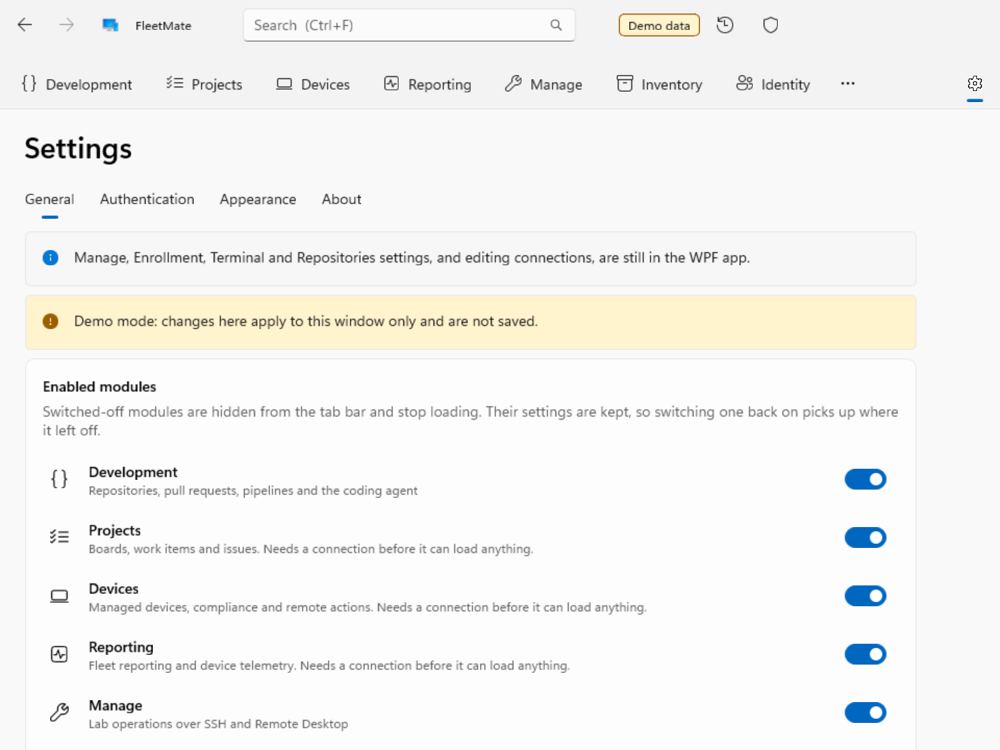
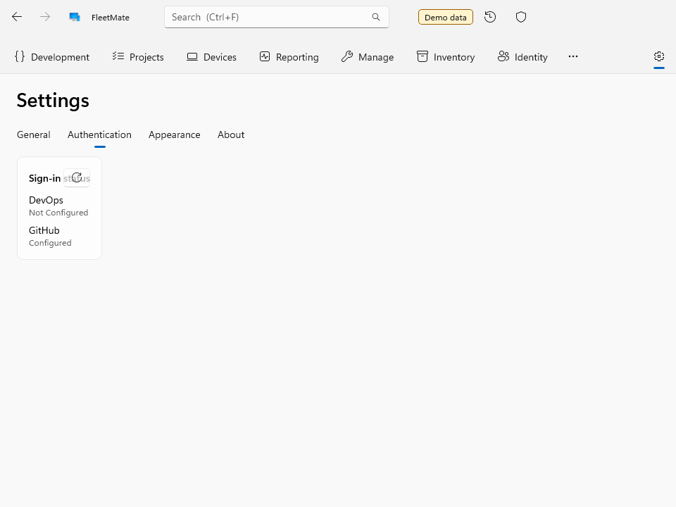
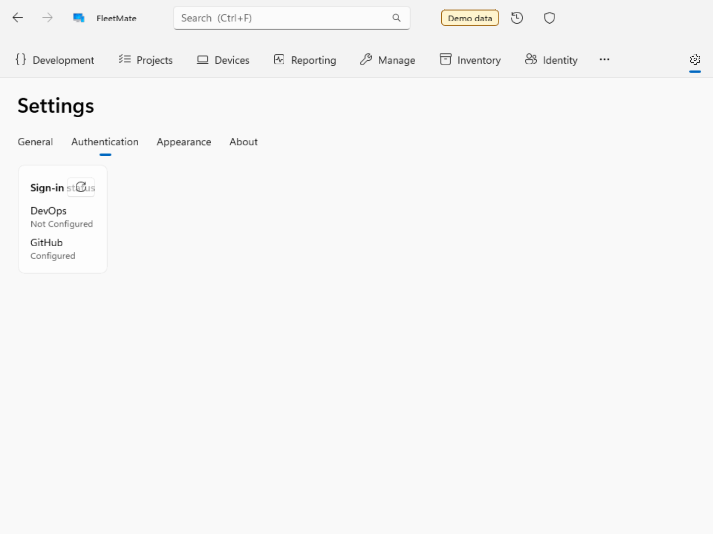
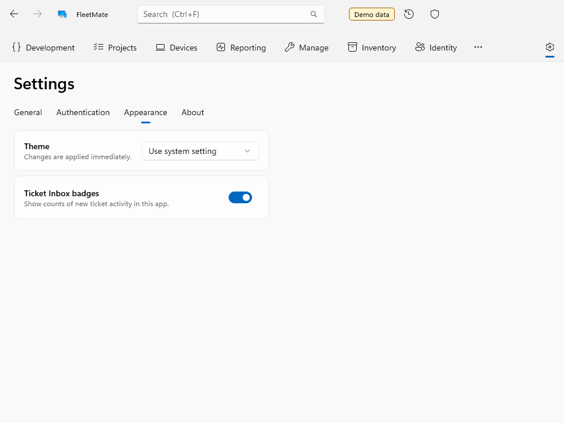
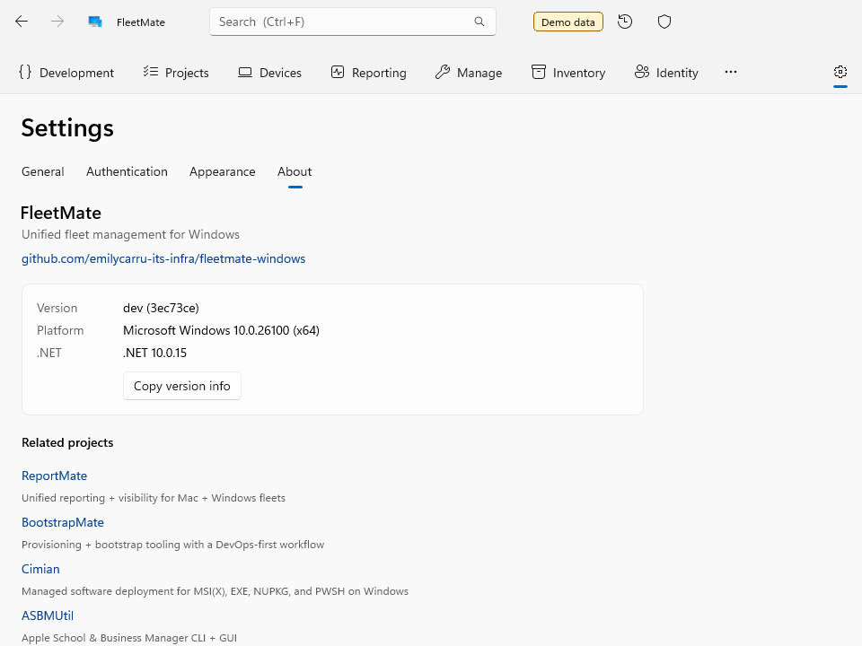
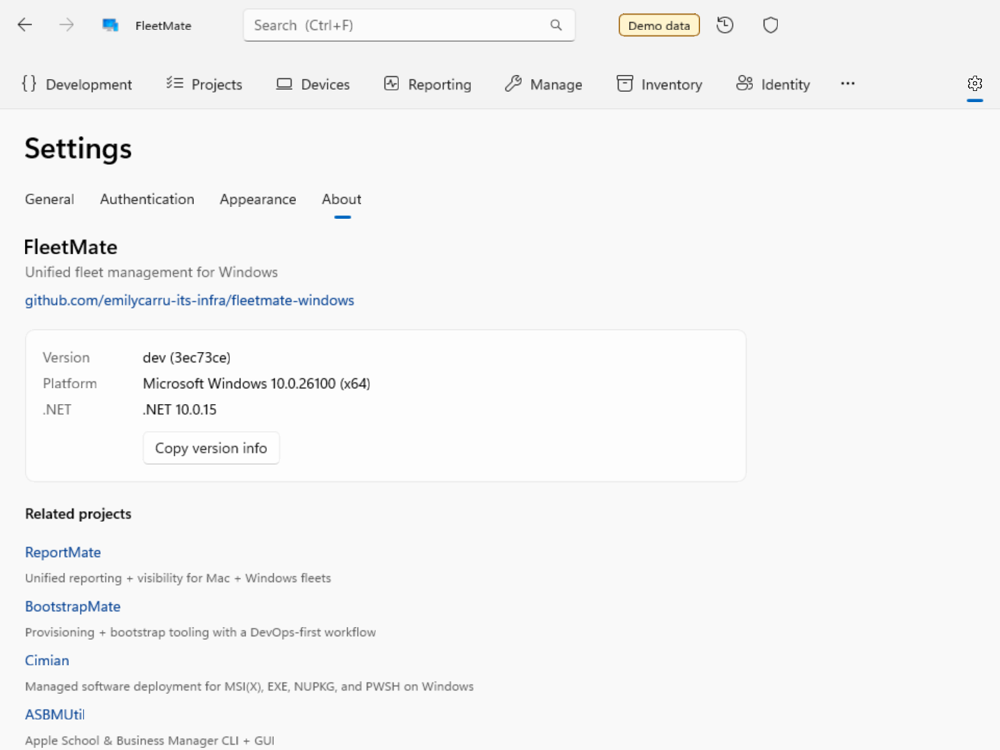
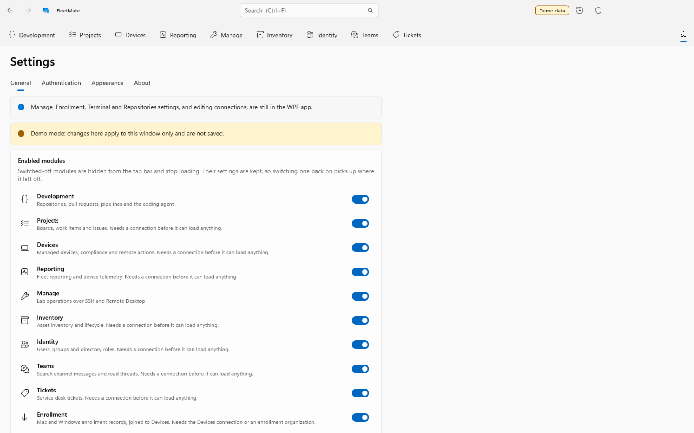
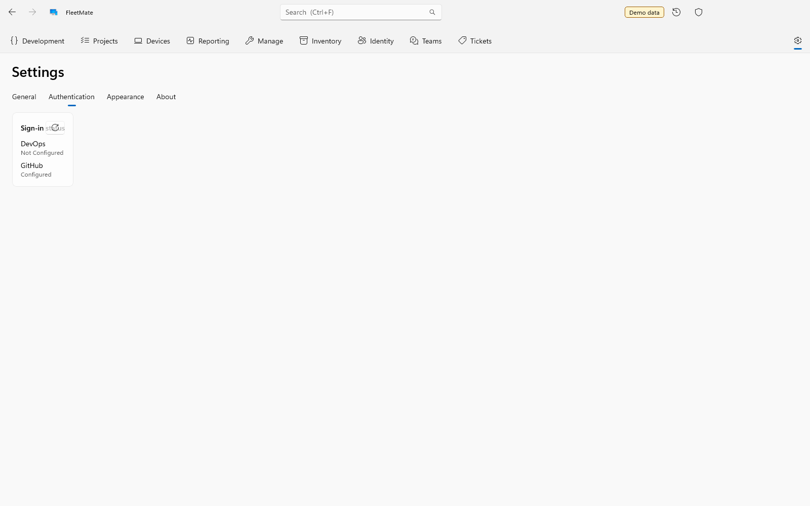
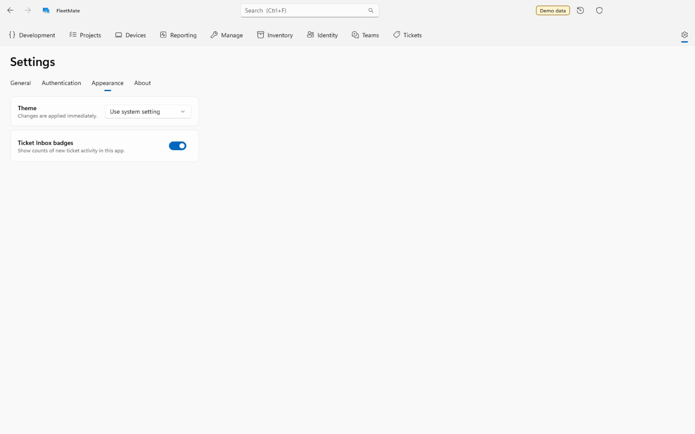
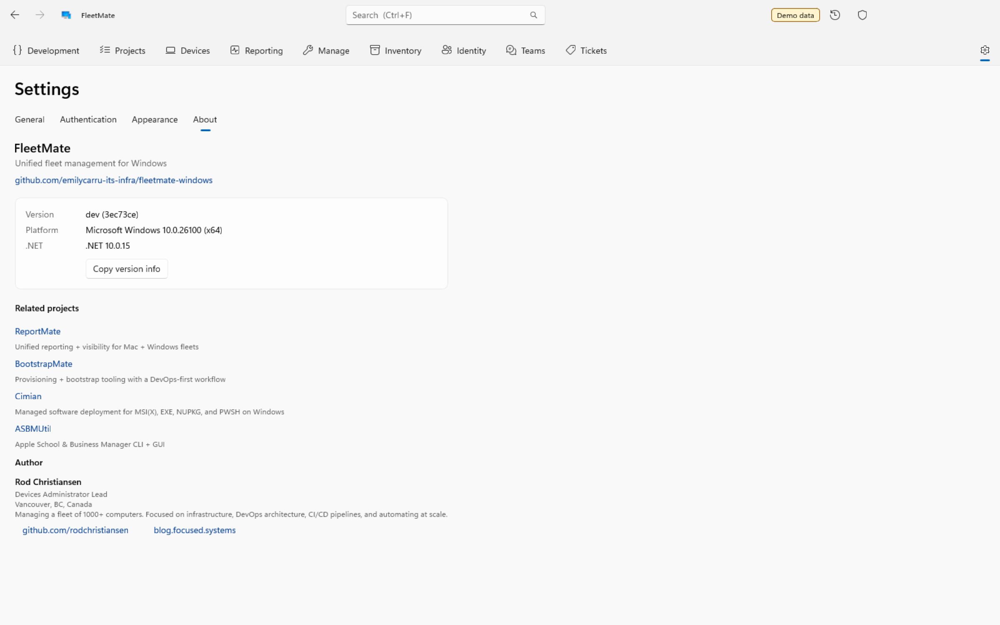

<!-- findings: 35 -->
# FleetMate WinUI QA capture

Captured 2026-11-26 09:33. High contrast in Windows: off.

## Development, Light, narrow (960x720)

No clipped text or unnamed controls.

## Development-pulls, Light, narrow (960x720)

No clipped text or unnamed controls.

## Development-pulls-detail, Light, narrow (960x720)

No clipped text or unnamed controls.

## Development-pulls-graphs, Light, narrow (960x720)

No clipped text or unnamed controls.

## Development-commits, Light, narrow (960x720)

No clipped text or unnamed controls.

## Development-pipelines, Light, narrow (960x720)

No clipped text or unnamed controls.

## Development-skills, Light, narrow (960x720)

No clipped text or unnamed controls.

## Development-skills-detail, Light, narrow (960x720)

No clipped text or unnamed controls.

## Projects, Light, narrow (960x720)

No clipped text or unnamed controls.

## Devices, Light, narrow (960x720)

No clipped text or unnamed controls.

## Reporting, Light, narrow (960x720)

No clipped text or unnamed controls.

## Manage, Light, narrow (960x720)

No clipped text or unnamed controls.

## Inventory, Light, narrow (960x720)

No clipped text or unnamed controls.

## Identity, Light, narrow (960x720)

No clipped text or unnamed controls.

## Teams, Light, narrow (960x720)

No clipped text or unnamed controls.

## Tickets, Light, narrow (960x720)

- Clipped text: "In Process" (TextBlock)
- Clipped text: "New" (TextBlock)
- Clipped text: "Awaiting Input" (TextBlock)
- Clipped text: "On Hold" (TextBlock)
- Clipped text: "Emergency" (TextBlock)
- Clipped text: "8–30 days" (TextBlock)
- Clipped text: "Over 30 days" (TextBlock)
- Clipped text: "Unassigned" (TextBlock)
- Clipped text: "Jordan Lee" (TextBlock)
- Clipped text: "Casey Nguyen" (TextBlock)
- Clipped text: "Morgan Diaz" (TextBlock)
- Clipped text: "Endpoint Team" (TextBlock)
- Clipped text: "Classroom Technology" (TextBlock)
- Clipped text: "Identity & Access" (TextBlock)
- Clipped text: "Service Desk" (TextBlock)
- Clipped text: "Print Services" (TextBlock)
- Clipped text: "Mia Laurent · Identity & Access" (TextBlock)
- Clipped text: "Lucas Brandt · Network" (TextBlock)
- Clipped text: "Zoe Martin · Endpoint Team" (TextBlock)
- Clipped text: "Priya Shah · Classroom Technology" (TextBlock)
- Clipped text: "Avery Kim · Endpoint Team" (TextBlock)
- Clipped text: "Grace Ito · Endpoint Team" (TextBlock)
- Clipped text: "Noah Fischer · Identity & Access" (TextBlock)
- Clipped text: "Leo Varga · Network" (TextBlock)
- Clipped text: "Ethan Moore · Endpoint Team" (TextBlock)
- Clipped text: "Lena Ortiz · Print Services" (TextBlock)
- Clipped text: "Omar Haddad · Software Licensing" (TextBlock)
- Clipped text: "Hannah Weiss · Identity & Access" (TextBlock)
- Clipped text: "Diego Ramos · Classroom Technology" (TextBlock)
- Clipped text: "Isla Novak · Service Desk" (TextBlock)
- Clipped text: "Felix Dubois · Endpoint Team" (TextBlock)
- Clipped text: "Ruby Clarke · Service Desk" (TextBlock)
- Clipped text: "Ava Rossi · Classroom Technology" (TextBlock)

## Settings, Light, narrow (960x720)

No clipped text or unnamed controls.

## Settings-authentication, Light, narrow (960x720)

No clipped text or unnamed controls.

## Settings-appearance, Light, narrow (960x720)

No clipped text or unnamed controls.

## Settings-about, Light, narrow (960x720)

No clipped text or unnamed controls.

## Development, Light, wide (1600x1000)

No clipped text or unnamed controls.

## Development-pulls, Light, wide (1600x1000)

No clipped text or unnamed controls.

## Development-pulls-detail, Light, wide (1600x1000)

No clipped text or unnamed controls.

## Development-pulls-graphs, Light, wide (1600x1000)

No clipped text or unnamed controls.

## Development-commits, Light, wide (1600x1000)

No clipped text or unnamed controls.

## Development-pipelines, Light, wide (1600x1000)

No clipped text or unnamed controls.

## Development-skills, Light, wide (1600x1000)

No clipped text or unnamed controls.

## Development-skills-detail, Light, wide (1600x1000)

No clipped text or unnamed controls.

## Projects, Light, wide (1600x1000)

No clipped text or unnamed controls.

## Devices, Light, wide (1600x1000)

No clipped text or unnamed controls.

## Reporting, Light, wide (1600x1000)

No clipped text or unnamed controls.

## Manage, Light, wide (1600x1000)

No clipped text or unnamed controls.

## Inventory, Light, wide (1600x1000)

No clipped text or unnamed controls.

## Identity, Light, wide (1600x1000)

No clipped text or unnamed controls.

## Teams, Light, wide (1600x1000)

No clipped text or unnamed controls.

## Tickets, Light, wide (1600x1000)

- Clipped text: "Classroom Technology" (TextBlock)
- Clipped text: "Identity & Access" (TextBlock)

## Settings, Light, wide (1600x1000)

No clipped text or unnamed controls.

## Settings-authentication, Light, wide (1600x1000)

No clipped text or unnamed controls.

## Settings-appearance, Light, wide (1600x1000)

No clipped text or unnamed controls.

## Settings-about, Light, wide (1600x1000)

No clipped text or unnamed controls.

